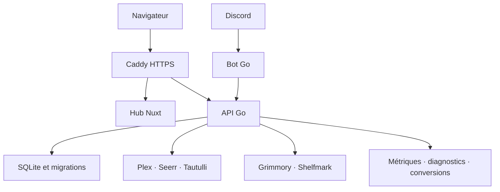

# Architecture du Concierge et du Hub

## État du projet

Les dépôts publics et le backlog sont initialisés. Les fonctionnalités ci-dessous constituent la cible de développement ; aucune application n’est encore livrée ou déployée. Les versions V0–V5 désignent des jalons fonctionnels, pas des releases disponibles.

## Répartition

| Dépôt | Responsabilités |
| --- | --- |
| [le-concierge](https://github.com/hloiseau/le-concierge) | API HTTP Go, règles métier, persistance, intégrations et bot Discord Go |
| [le-hub](https://github.com/hloiseau/le-hub) | Portail Nuxt/TypeScript et client de l’API commune |

Le Concierge comprendra deux exécutables (`cmd/api`, `cmd/bot`) avec des cycles de vie indépendants. L’API possède la base et les règles métier ; le bot et le portail la consomment. Le contrat HTTP versionné est maintenu dans `le-concierge`. Le Hub n’accède pas directement aux secrets ou à la base des services connectés.

Le mode d’interaction Discord sera arrêté à l’implémentation. Ce schéma ne suppose pas que le trafic Gateway Discord passe par Caddy. Les routes HTTP, cookies et en-têtes du reverse proxy seront documentés avec le déploiement.

## Identité et droits

Connexion Discord pour le portail, puis liaison vérifiée des comptes Plex et Seerr. Une présence dans Discord ne constitue pas une autorisation d’accès à toutes les bibliothèques. Les associations utilisent des identifiants stables et une preuve de contrôle, jamais un simple nom ou email.

Le brief mentionne « Plex OAuth2 » ; le projet de référence Torrent Watch utilise un flux PIN. Le protocole effectif sera validé dans [Concierge #4](https://github.com/hloiseau/le-concierge/issues/4). Les tokens restent côté serveur ; contrôles d’accès, révocation, cookies et protection CSRF font partie de ce ticket.

Le bot transmet une identité issue d’une interaction Discord authentifiée. Son identité de service ne doit pas permettre l’usurpation arbitraire d’un utilisateur. Les demandes personnelles et les contenus restreints sont filtrés côté API. Les diagnostics et les détails nominatifs des sessions Plex sont réservés aux administrateurs.

## Données et événements

SQLite est la cible initiale, avec migrations et sauvegardes cohérentes. Seul le processus API écrit dans la base. PostgreSQL pourra être évalué si les contraintes d’exploitation le justifient ; deux moteurs ne sont pas promis dès la première version.

Seerr reste la source des demandes multimédia et conserve ses notifications existantes. Le Concierge ajoute les abonnements collectifs et les notifications ciblées. Une matrice explicite définit quel outil notifie les demandeurs et les abonnés pour éviter les doublons.

Un téléchargement terminé ne signifie pas qu’un contenu est disponible : l’import et la présence dans Plex ou Grimmory doivent être confirmés. Les futurs événements utilisent des identifiants stables, une outbox persistante et une déduplication. Les erreurs amont, données absentes et caches périmés sont distingués.

## Intégrations

| Domaine | Services | Limites à lever |
| --- | --- | --- |
| Films et séries | Plex, Seerr, Tautulli | Versions API, identité, bibliothèques autorisées et fraîcheur des données |
| Diagnostic | Radarr, Sonarr | Corrélation demande/import, lecture seule et masquage des détails sensibles |
| Livres et mangas | Grimmory, Shelfmark | Recherche, demande, import, métadonnées et authentification réelles |
| Liseuses | Intégration Kobo disponible | Aucun état de synchronisation inventé si l’API ne le fournit pas |
| Performances | TrueNAS, système, Intel Arc | Collecte et unités vérifiées, permissions minimales, stockage historique |
| Téléchargements | LibraryDownloadarr | API du fork, conversions, progression et droits utilisateur |
| Communauté | Forums Discord et sélection d’issues GitHub | Permissions des salons, source unique des votes et filtrage public |

La page d’accueil propose aussi un lien vers Torrent Watch. La centralisation des liens n’implique pas un SSO automatique entre toutes les applications. Les API Grimmory/Shelfmark et les métriques Arc font l’objet de tickets d’investigation avant engagement sur leurs capacités.

## Déploiement cible

Conteneurs sur TrueNAS SCALE, Caddy pour HTTPS, images GHCR versionnées après validation CI. Les accès internes et secrets restent configurables, avec exemples fictifs. Pas de socket Docker dans le portail ; toute collecte nécessitant un accès matériel est isolée et justifiée.

Le monitoring exposera une vue utilisateur agrégée et une vue administrateur plus détaillée. Cadence, rétention, budget disque et coût de collecte seront mesurés avant le choix du stockage temporel.

## Ordre de livraison

1. API, identités, persistance, intégrations Seerr/Plex et commandes du bot V1.
2. Hub V0/V1 : accueil, liens, connexion et demandes personnelles.
3. Livres : audit des API, catalogue, demandes/imports, collections et Kobo selon capacités.
4. Monitoring : collecte, historique et graphiques système/Plex.
5. Abonnements et notifications, communauté, Downloadarr et diagnostics administrateur.

La numérotation du texte de la roadmap initiale fait référence. Les abonnements annoncés dans l’espace personnel sont préparés dans le Hub V1 et activés lorsque le backend de phase 5 est livré. L’accueil V0 peut sortir sans les livres, qui seront ajoutés après l’intégration Grimmory.

## Références existantes

- [Torrent Watch](https://github.com/hloiseau/torrent-watch) : parcours Plex, contrôle d’accès, gestion des pannes et déploiement TrueNAS/Caddy.
- [LibraryDownloadarr](https://github.com/hloiseau/LibraryDownloadarr/tree/codex/download-quality-a6fa824141dc) : branche des conversions et choix de qualité ; version effectivement déployée à confirmer.
- [Ouicheur](https://github.com/hloiseau/ouicheur) : organisation documentaire et modèles de contribution.
- [mcp-gopls](https://github.com/hloiseau/mcp-gopls) : conventions de structure Go.
- [AnimeBot](https://github.com/hloiseau/AnimeBot) : expérience Discord antérieure en Kotlin/JDA.

Ces références servent de point de départ. Tout code repris conservera ses obligations de licence.
